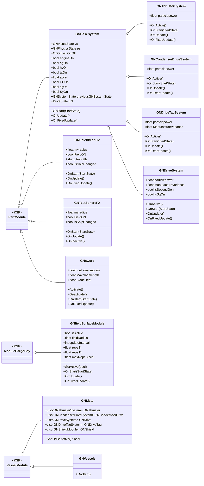
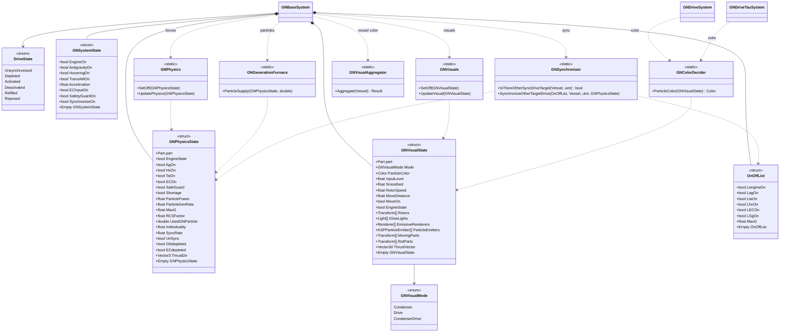
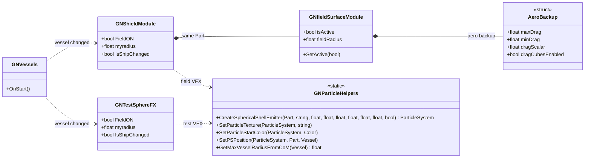
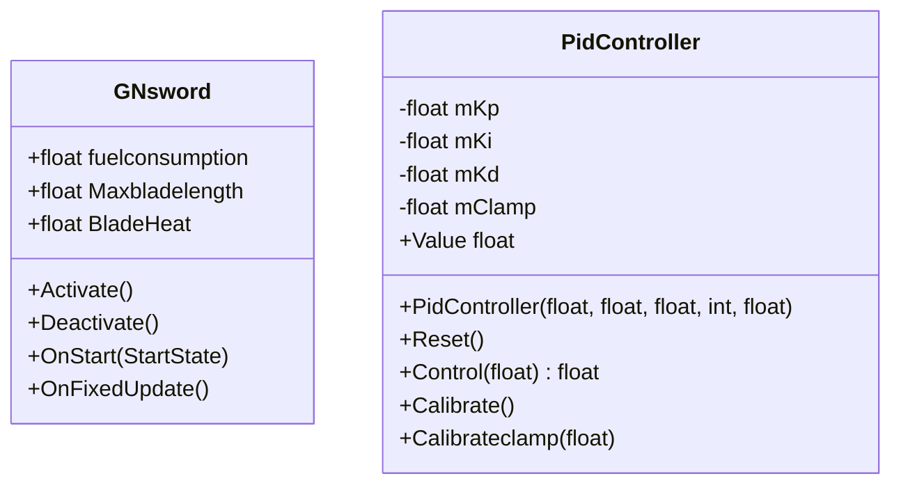

# GNdrive class diagram

This document summarizes the main classes, structs, and static helpers in the GNdrive mod as Mermaid class diagrams.

## Overview

## Drive state and services

## Shield and field modules

## Other utility modules

## Source map

- `GNDriveCore.cs`: `GNBaseSystem`, drive subclasses, `DriveState`, `GNSystemState`
- `GNPhysics.cs`: `GNPhysicsState`, `GNPhysics`, `GNGenerationFurnace`
- `GNVisuals.cs`: `GNVisualState`, `GNVisualMode`, `GNVisuals`, `GNColorDecider`
- `GNMechanics.cs`: `GNLists`, `GNVisualAggregator`, `GNSynchronizer`
- `GNshield.cs`: `AeroBackup`, `GNParticleHelpers`, `GNTestSphereFX`, `GNShieldModule`, `GNfieldSurfaceModule`
- `GNVessels.cs`: `GNVessels`
- `GNsword.cs`: `GNsword`
- `PID.cs`: `PidController`
